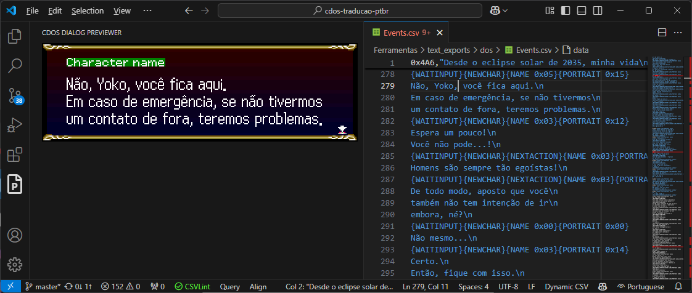
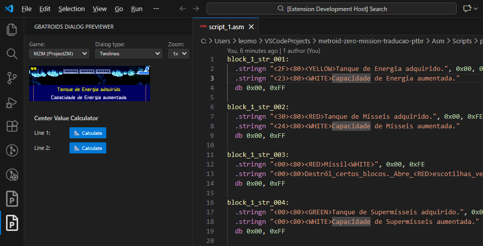
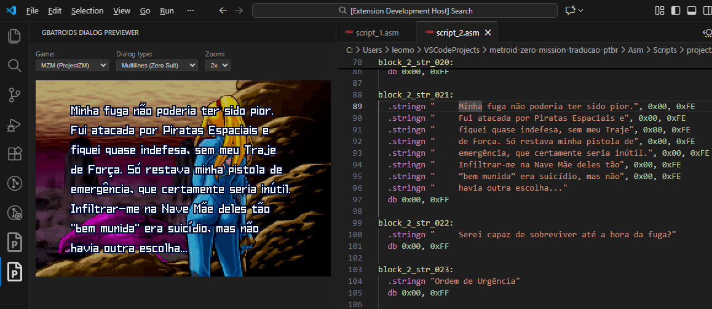
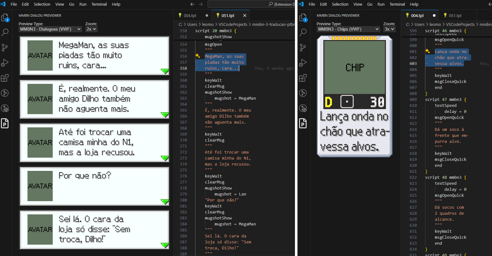
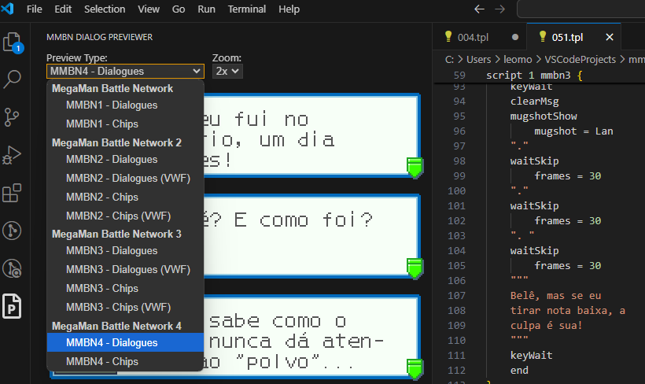

# Game Dialog Previewer

Essa é uma extensão do VSCode que permite pré-visualizar scripts de diversos jogos, em formatos diversos.

Ela adiciona uma sidebar à esquerda, que quando ativa, exibe uma área que escuta eventos chamados quando um arquivo é editado no VSCode. Através desses eventos, desde que o usuário esteja editando os arquivos nos formatos esperados por cada jogo, será exibida uma prévia de como o diálogo apareceria ingame.

## Jogos e formatos

- **MegaMan Battle Network 1 a 5**: Arquivos `.tpl` exportados pelo [TextPet](https://github.com/Prof9/TextPet). Desenlvolvido pensando em vários jogos da série, tanto nas fontes originais como em fontes VWF customizadas oriundas de traduções PT-BR do MegaMan Battle Network 2 e 3. Também conta com diferentes modos de pré-visualização, seja de diálogos comuns ou de descrições de chips/subchips/PAs/etc.
- **Castlevania de Nintendo DS (atualmente Dawn of Sorrow)**: Arquivos `.csv` exportados pelo [DSVania Editor](https://www.romhacking.net/utilities/1271/). Desenlvolvido focando apenas no arquivo "Events.csv", que é o que contém todos os textos do modo história e é o mais volumoso. Os demais scripts em sua maioria podem ser traduzidos manualmente sem necessidade de pré-visualização.
- **Metroid Zero Mission e Metroid Fusion**: Arquivos `.asm` nos formatos dos projetos de tradução de [Metroid Zero Mission](https://github.com/leomontenegro6/metroid-zero-mission-traducao-ptbr) e Metroid Fusion. Desenvolvido levando em consideração as possíveis variações de fontes neles (originais ou reduzidas), bem como suas respectivas larguras VWF. Também conta com diferentes modos de pré-visualização, seja de diálogos de duas linhas como falas ou mensagens de obtenção de itens, até cutscenes de múltiplas linhas.
- **Pokémon (gen1 e gen2)**: Arquivos `.asm` no formatos dos projetos [de disasm de pokémon](https://github.com/pret/), e arquivos `.lua` no formato do [gen1recomp](https://github.com/bryanthaboi/gen1recomp). Desenvolvido para facilitar na tradução e revisão de jogos seja nos jogos originais ou na forma de mods para os jogos nativos recompilados.

# Como utilizar

Baixe o arquivo "game-dialog-previewer-0.0.1.vsix" e [instale-o manualmente no seu VSCode](https://code.visualstudio.com/docs/editor/extension-marketplace#_install-from-a-vsix).

Se feito corretamente, aparecerá um ícone de uma folha de papel com uma letra "P" ao centro, que quando clicado, mostrará as prévias dos diálogos em tempo real. A prévia considera a posição do cursor de texto, tenta determinar o diálogo que o cursor está, e por fim pega seus caracteres para exibir na prévia. Há opções de customização adicional, como zoom, tipos de diálogo para cada jogo, etc.

Utilizando dessa prévia, é possível determinar quando um diálogo está próximo do limite da tela ou não, para poder ajustá-lo de acordo, sem precisar testar ingame.

# Como essa extensão foi desenvolvida?

Como eu já havia desenvolvido três previewers diferentes ([mmbn-dialog-previewer](https://github.com/leomontenegro6/mmbn-dialog-previewer), [cdos-dialog-previewer](https://github.com/leomontenegro6/cdos-dialog-previewer) e [gbatroids-dialog-previewer](https://github.com/leomontenegro6/gbatroids-dialog-previewer)), decidi finalmente mesclar todos eles em um só, e tentar tornar as implementações o mais genéricas possível. Pus todos os repositórios num mesmo workspace do VSCode, e usando GitHub Copilot, orientei via prompts para criar um previewer unificado, seguindo os padrões do gbatroids que é o mais amadurecido dos três (usando React e Sass no webview, e typescript no backend). É seguro dizer que pelo menos 80% do código foi redigido dessa forma, comigo repassando os requisitos e passando por vários prompts e iterações até atingir o resultado satisfatório.

Já na parte de compilar ela para arquivos .vsix, eu segui [essas instruções referentes a como publicar extensões](https://code.visualstudio.com/api/working-with-extensions/publishing-extension). Elas ensinam não só como compilar arquivos .vsix, como também como publicá-las no Marketplace do VSCode. No meu caso, por essa ser uma extensão bem específica e útil apenas para poucos casos de uso específicos, optei por distribuir o .vsix manualmente por aqui mesmo. Ao meu ver, seria mais válido estar no Marketplace se fosse uma solução mais genérica, mas como torná-la genérica daria um trabalhinho considerável, optei por fazer desta maneira.

# Disclaimer

Criei esta ferramenta para me auxiliar em diversas fã-traduções PT-BR que trabalhei no passado. Estou disponibilizando o código para quem se interessar. Sintam-se livres para utilizar do seu código à vontade, seja para adaptar para outros jogos ou para torná-la algo ainda maior do que atualmente é.